<!-- Animated Terminal Header -->

  

  Software Development • Web Technologies • Problem Solving

---

## 👩‍💻 About Me

I'm a final-year B.Tech CSE student focused on software development and building practical, user-centric applications.

- ⚡ Turning ideas into functional applications
- 💻 Exploring modern web technologies and software development
- 🧩 Strengthening programming and problem-solving skills
- 🎯 Focused on clean code and continuous improvement
- 🤝 Open to collaboration and professional opportunities

---

## 🛠️ Tech Stack

---

## 🚀 Featured Projects

### 🔹 CodeSync

A software development project focused on applying programming concepts and building practical solutions.

🔗 [View Repository](https://github.com/KrutiJaiswal/CodeSync)

---

### 🔹 YouTube Clone

A YouTube-inspired web application exploring frontend development, interface design, and modern web technologies.

🔗 [View Repository](https://github.com/KrutiJaiswal/Youtube-clone)

---

## 🏆 Certifications

- 📜 Python Certification

---

## 🧠 Coding Profiles

---

## 📊 GitHub Analytics

  
  

---

## 🔗 Connect With Me

---

  <i>Learn. Build. Improve.</i>

